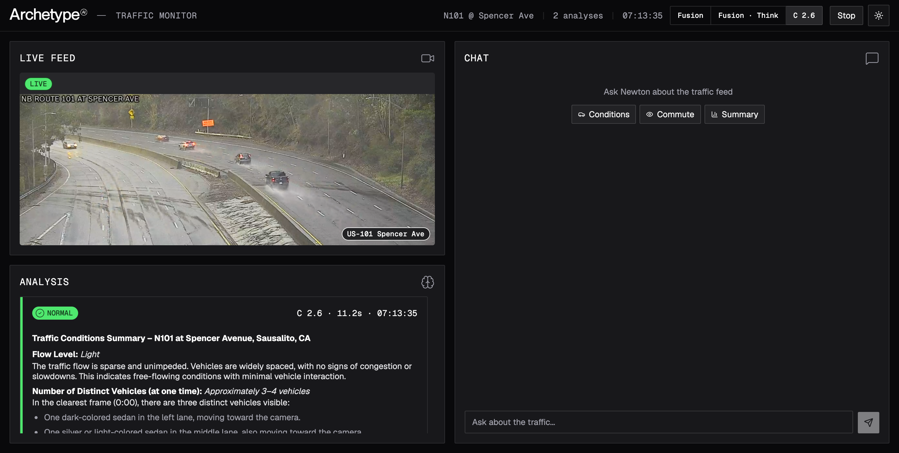

# Newton Traffic Demo (Inference API)

Real-time traffic monitoring dashboard powered by [Newton](https://www.archetypeai.io/) and a live Caltrans CCTV feed.

Analyzes the **US-101 at Spencer Avenue** camera (Sausalito, CA — Golden Gate Bridge approach) through the **Inference API**, with a choice of **Newton C 2.6** (default) or **Newton Fusion 1.0**, and an interactive chat for asking questions about current traffic conditions.

This is the Inference API version of [archetypeai-traffic-demo](https://github.com/archetypeai/archetypeai-traffic-demo), which uses the Direct Query API.



## Features

- **Live HLS stream** from Caltrans CCTV (1280x720, US-101 northbound) — the publisher
  drops in and out, so the player retries a failed manifest with exponential backoff
  rather than leaving the feed blank
- **Automatic analysis** — every 8 seconds Newton analyzes a short clip, reporting on traffic flow, vehicle density, incidents, visibility, and whether traffic is building, clearing, or steady
- **Model picker** in the menubar, used for both analysis and chat:

  | Option              | Model               | What it does                                                         |
  | ------------------- | ------------------- | -------------------------------------------------------------------- |
  | **C 2.6** (default) | `newton-c-2.6`      | 8B model; no reasoning step                                          |
  | **Fusion**          | `newton-fusion-1.0` | Appends `/no_think` so the model answers directly (512 tokens)       |
  | **Fusion · Think**  | `newton-fusion-1.0` | Lets the model reason first (4096 tokens, `repetition_penalty: 1.1`) |

- **Model and latency on every answer** — each analysis and chat reply is labelled with the option that produced it and how long it took (e.g. `C 2.6 · 4.2s`)
- **Interactive chat** — ask Newton questions about what it sees on the camera
- **Analysis history** — scrolling log of observations with severity-coded labels (Normal, Congestion, Incident); failed calls show as **NO ANSWER** with the error

## Stack

- **SvelteKit** with Svelte 5 runes
- **Archetype AI Design System** — semantic tokens, component primitives, composite patterns
- **Geist and Geist Mono** — open-source fonts from `@fontsource-variable`
- **Newton Inference API** — stateless `POST /api/inference/query` with short video clips encoded server-side as MP4
- **ffmpeg** — muxes the captured JPEG frames into an MP4 clip (`brew install ffmpeg`)
- **hls.js** — HLS stream playback in the browser
- **Tailwind v4** — styling with semantic design tokens

## Setup

Requires Node.js 20 or later and [ffmpeg](https://ffmpeg.org) on your `PATH` (`brew install ffmpeg` on macOS):

```bash
git clone https://github.com/archetypeai/archetypeai-traffic-demo-inference-api.git
cd archetypeai-traffic-demo-inference-api
npm install
cp .env.example .env      # then add your API key
```

`.env` holds your Archetype AI API key and the production endpoint:

```
ATAI_API_KEY=your_api_key_here
ATAI_API_ENDPOINT=https://platform.u1.archetypeai.app
```

The `.env` file wins over any `ATAI_*` variables exported in your shell (see `vite.config.js`).

## Development

```bash
npm run dev
```

Open `http://localhost:5173`, pick a model, then click **Start Analysis**.

## Direct Query API → Inference API

|             | Before (Direct Query API)                                          | Now (Inference API)                                                                                                                                |
| ----------- | ------------------------------------------------------------------ | -------------------------------------------------------------------------------------------------------------------------------------------------- |
| Endpoint    | `POST /api/lens/query`                                             | `POST /api/inference/query`                                                                                                                        |
| Model       | `Newton::c2_6_8b_fp8_260424d7a55d5e` (C 2.6)                       | `newton-c-2.6` (default) or `newton-fusion-1.0`, picked in the menubar                                                                             |
| Video input | `data.base64_img` events + `multi_image: false` + `query_metadata` | One MP4 clip in `file_ids` as `base64:<mp4>`; image events, `multi_image: true`, and `max_frames` are refused                                      |
| System turn | `instruction_prompt`                                               | `system_prompt` (`instruction_prompt` is just appended to the query text)                                                                          |
| Frames used | All captured frames                                                | Up to 16 frames per clip, each resized to 224 × 224 (fixed by the model's blueprint)                                                               |
| Reply       | Plain text                                                         | C 2.6: plain text. Fusion: starts with a `<think>…</think>` block, stripped server-side. `/no_think` skips reasoning; `/think` does _not_ force it |

## Latency

Measured on production on 2026-11-14 with a 4-frame clip from the live feed, three calls per option, model already warm:

| Option         | Analysis prompt      | Short chat question |
| -------------- | -------------------- | ------------------- |
| C 2.6          | ~10 s (long answers) | ~3 s                |
| Fusion         | ~5 s                 | ~2 s                |
| Fusion · Think | ~19–21 s             | ~2 s                |

The first call after a model has been idle takes 35–40 s while a replica starts.

## Architecture

```
src/
├── routes/
│   ├── +page.svelte              # Dashboard orchestrator + model picker
│   └── api/
│       └── analyze/+server.js    # Stateless /api/inference/query proxy (video-clip analysis)
├── lib/
│   ├── server/newton.js          # Inference API client: MODES, MP4 muxing, think-block stripping
│   ├── api/newton.js             # Client-side fetch wrappers
│   └── components/ui/
│       ├── primitives/           # DS registry primitives
│       ├── patterns/             # DS registry patterns
│       └── custom/               # Project-specific components
│           ├── traffic-feed.svelte    # HLS player + status overlay
│           ├── chat-panel.svelte      # Interactive Q&A with Newton
│           └── analysis-log.svelte    # Scrolling analysis history
```

## How It Works

1. The HLS stream plays via hls.js in a `<video>` element (self-healing: recovers from transient stream errors)
2. **Start Analysis** begins the polling loop — no session to create; each call is a stateless `/api/inference/query`
3. Every 8 seconds, 4 frames (~1.3 fps) are captured via canvas as JPEG, muxed on the server into a short H.264 MP4 at the capture rate, and sent as `file_ids: ["base64:<mp4>"]` with the selected model
4. The reply (with any `<think>` block removed) is shown in the Analysis panel with auto-inferred severity, the model label, and the latency
5. Questions in the Chat panel capture the current clip and send it with the question to the same model

## Licence

The code is licensed under the [Apache License 2.0](LICENSE). The camera feed is streamed live from Caltrans and is not part of this repository.
